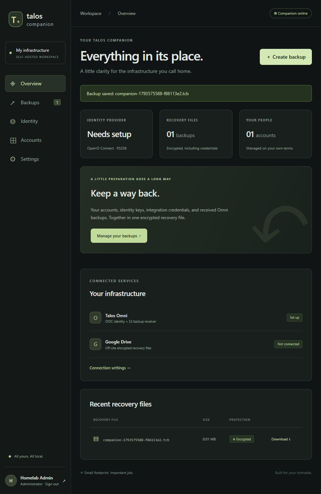

# Talos Companion

A small, self-hosted Rust + React application for Talos Omni identity and recovery. Deploy it on Unraid with one container. The final Docker image is built **from scratch, with exactly one filesystem layer containing only a static Rust executable and the compiled frontend**.



## What it does

- First launch: create an administrator or restore an encrypted recovery file.
- Restore: optionally replace the first administrator’s name, email, and password while preserving their OIDC subject ID and all other accounts.
- Identity: a dedicated OIDC provider for Omni, with discovery, RS256/JWKS, authorization codes, S256 PKCE, and userinfo.
- Accounts: administrators can create/remove accounts; members can change their own password and sign in to Omni.
- Receiver: authenticated S3 API, including multipart uploads, backed by the Rust `s3s`/`s3s-fs` libraries. Omni’s bucket is created automatically.
- Recovery: encrypted snapshots include accounts, password hashes, signing keys, client credentials, Google tokens, uploaded Omni recovery material, and all received S3 data and metadata.
- Destinations: persistent local storage, authenticated browser download, Google Drive, and host-mounted NFS/SMB shares. Every remote transfer retains a local copy.
- Scheduling: daily by default, configurable in the administrator UI and persisted configuration file.

This is an initial implementation. The S3 backend uses the upstream experimental filesystem provider. Automated tests exercise signed S3 requests and multipart uploads; validate against your own Omni deployment before depending on it for recovery. Upload Omni encryption keys/configuration through the recovery-material vault to include them in snapshots. Companion does not automatically snapshot Omni’s own database or collect its encryption keys. See [Omni setup and recovery](docs/omni.md).

## Run on Unraid

The image is available on [Docker Hub](https://hub.docker.com/r/holblin/talos-companion): `holblin/talos-companion:0.1.1` or `holblin/talos-companion:latest`. Use `deploy/compose.hub.yaml` to run it without a source build. The generated Unraid template is ready for manual installation; Community Apps publication remains deferred. See [Unraid instructions](docs/unraid.md).

The application source, templates and documentation use the [MIT license](LICENSE).
Public Unraid templates for both Companion and Omni are available in
[talos-companion-unraid](https://github.com/holblin/talos-companion-unraid).

To build from source instead:

1. Clone this repository onto your build host.
2. Copy `.env.example` to `.env` and set your public URL. Leave the secret overrides empty to generate private persistent secrets automatically, or supply your own independent random values.
3. Pre-create the data and destination directories with ownership matching `PUID:PGID` (default `99:100`). For a local trial on Linux:

   ```sh
   mkdir -p data network-backups
   sudo chown 99:100 data network-backups
   chmod 700 data network-backups
   ```

4. Run `docker compose up -d --build` (or `mise run up`).
5. Open the configured public URL. Find the generated setup token in first-start container logs (or `/data/setup-token`), then create an administrator or restore a `.tcb` file. At Review, save the backup passphrase outside the server, check the saved box, and re-enter it to confirm. Uncheck to reveal it again if needed.

The image runs as an unprivileged numeric user with a read-only root filesystem. `/data` must be writable. The container needs no shell, Node, rclone, dynamically linked libraries, or CA files; the Rust HTTPS client includes public trust roots.

See [Unraid instructions](docs/unraid.md), [Omni configuration](docs/omni.md), and [Google Drive setup](docs/google-drive.md).

See [Docker Hub publishing and Unraid template preparation](docs/publishing.md) for the release workflow, registry-only Compose file, and public template bundle. Registry upload is opt-in. Community Apps catalog review is separate from public template availability.

## Development with mise

Install [mise](https://mise.jdx.dev/), then:

```sh
mise trust
mise install
mise run web:install
```

Tool versions live in `mise.toml`; download metadata lives in `mise.lock`. Rust and npm dependencies have their own committed lockfiles. The frontend pins React 19.3.1, Vite 8.3.5, and TypeScript 6.0.3; TypeScript stays within the version range supported by the strict type-aware lint tooling.

Optionally set `SETUP_TOKEN` (24+ characters) and `BACKUP_PASSPHRASE` (16+ characters) in your shell. Otherwise a fresh installation generates private persistent `/data/setup-token` and `/data/backup-passphrase` files with mode `0600`; the setup token appears in the first-start logs. The backup passphrase is shown only in the token-protected setup wizard. An initialized installation never silently replaces missing secret files. `.env` is used by Docker Compose; it is not automatically read by the Rust executable.

```sh
# Terminal 1: backend. This task sets PUBLIC_URL=http://localhost:5173.
mise run dev
# Terminal 2: Vite, with API/OIDC proxies to the backend.
mise run web:dev
```

Open `http://localhost:5173`. Native Windows Rust builds require Visual Studio C++ build tools. Docker builds target Linux amd64 with musl, appropriate for Unraid.

```sh
mise run web:build  # TypeScript validation + production frontend
mise run check      # Rust formatting, Clippy, unit tests
mise run test       # Unit tests + full HTTP/S3 recovery integration test
mise run build      # Frontend + release executable
mise run docker:build
```

CI uses mise for the same checks and verifies the built image has exactly one layer. It also checks the scratch container can serve the frontend and run its own health probe.

## Language safety checks

Project-owned Rust code forbids `unsafe` in every target, including tests. Compiler warnings and Clippy's standard lint group are errors. This policy does not ban unsafe implementation details inside the Rust standard library or third-party crates.

The frontend and Vite configuration use TypeScript strict mode, checked indexed access, exact optional properties, dependency declaration checking, and unused/unreachable-code checks. Type-aware ESLint uses `strictTypeChecked` and rejects explicit `any`, unsafe operations, non-null assertions, and TypeScript suppression comments; inline ESLint overrides are disabled. Every frontend build runs these checks. TypeScript is pinned to 6.0.3, the newest stable release supported by the type-aware lint tooling; TypeScript 7 is currently outside its supported range. The lint dependency tree pins minimatch 11.0.1 to avoid the glob amplification advisory.

Run `mise run check` and `mise run web:check` locally; GitHub Actions runs both.

## Configuration

First launch opens a guided installation wizard: choose a fresh installation or recovery, verify the setup token, enter administrator or recovery details, choose an initial backup routine, and review before applying. The final checklist explains Omni integration, external destinations, and the first recovery file. Recovery can replace the first administrator’s credentials while preserving identity and other accounts. Setup-token validation reveals deployment details only to someone holding that token.

Environment variables are startup values supplied by Docker. Only deployment paths, network addresses, and startup secrets use them. Administrators manage retention and scheduled backups in **Settings → Backup settings**, without restarting the container. Defaults are seven recovery files per destination, 30 Omni snapshots per cluster, and a daily local backup. Set a retention count to zero to keep everything; scheduling can be disabled.

The UI atomically saves settings in `/data/config.json`. To edit the file manually, stop the container, edit it, and restart. Invalid configuration prevents startup instead of silently replacing your choices. Supported fields:

```json
{
  "retention": { "recovery_keep_last": 7, "snapshot_keep_last": 30 },
  "schedule": { "enabled": true, "interval_seconds": 86400, "destination": "local" }
}
```

Intervals range from 60 seconds to one year; destinations are `local`, `mounted`, or `drive`. Saving resets the schedule timer. An active backup finishes using the settings it started with. Recovery files include this configuration and restore it with your accounts. Deployment paths and startup secrets still come from the replacement container.

Local and mounted retention runs after a successful write. Drive retention runs after a successful upload and moves expired application-tagged recovery files in its configured folder to Trash. Remote failures preserve the new local recovery file and appear in the UI/logs. Use dedicated destination directories/folders for this instance.

| Variable | Default | Purpose |
| --- | --- | --- |
| `PUBLIC_URL` | `http://localhost:8080` | Exact browser origin and OIDC issuer; use HTTPS in deployment. |
| `SETUP_TOKEN` | generated on fresh installation | Optional override protecting setup and restore. Minimum 24 characters; otherwise persisted privately in `/data/setup-token`. |
| `BACKUP_PASSPHRASE` | generated on fresh installation | Optional override encrypting new backups. Minimum 16 characters; otherwise persisted privately in `/data/backup-passphrase`. Save a separate recovery copy. |
| `DATA_DIR` | `data` (`/data` in Docker) | State, S3 receiver files, and recovery files. |
| `WEB_DIR` | `web/dist` (`/web` in Docker) | Compiled frontend. |
| `LISTEN_ADDR` | `0.0.0.0:8080` | Web/API listener. |
| `S3_LISTEN_ADDR` | `0.0.0.0:9000` | Authenticated S3 listener, starts after setup. |
| `MOUNTED_BACKUP_DIR` | unset | Existing directory for NFS/SMB/local copies. |

## Recovery and limits

The wizard Review step reveals the current backup passphrase so you can copy it or download a plain-text recovery note. Checking the saved box hides it and requires a matching re-entry before creation or restore. Both endpoints validate the confirmation on the server. To reveal it again, uncheck the box. During restore this is the replacement server's passphrase for **future** backups; the uploaded backup still needs its original passphrase.

Optionally download an age-encrypted recovery note using one or more native `age1` public keys or `ssh-ed25519`/`ssh-rsa` public keys. You can import supported public SSH keys from an explicitly selected GitHub username, review them, and download the note. The note contains the backup passphrase; the `.tcb` backup format and passphrase-based restore remain unchanged. Private keys never reach the server. Decrypt the note locally with `age -d -i /path/to/private-key talos-companion-recovery.txt.age`, then use the recovered passphrase to restore the backup. Keep a matching private key long-term, even if it is removed from GitHub. Hardware-backed SSH keys are unsupported. The note and the actual backup must both be retained.

Recovery files use the **version 2** binary envelope (`TCBACKUP` followed by byte `2`) and a standard passphrase-encrypted [age](https://age-encryption.org/v1) stream containing a tar archive. Each file gets independent encryption material. The scrypt work factor is fixed at `log_n=16` (about 64 MiB of KDF memory); restore rejects higher work factors. Payload encryption authenticates bounded 64 KiB chunks. The previous version 1 format is deliberately unsupported: recreate any old recovery files before using this version.

There is **no fixed recovery-file size cap**. Archive creation, encryption, browser downloads, mounted copies, restore uploads, and decryption stream through bounded buffers instead of loading whole archives into RAM. Google Drive reads at most 8 MiB of file data per upload request. Archive content is not compressed, so size is approximately the retained receiver data and credential files plus tar/encryption overhead. Available disk space, filesystem limits, and proxy configuration remain practical limits.

Creation writes an encrypted temporary file in `/data/backups`, completes encryption, syncs the file, and atomically publishes it. Failure does not publish a partial recovery file. Restore spools the encrypted upload to a private temporary file, then decrypts/extracts into a private staging directory. The stream is consumed through its final authentication tag before any state is replaced. Allow space for the encrypted upload **and** extracted data during restore, and configure your reverse proxy to allow large uploads and long-running requests.

Retention runs on backup creation, including scheduled backups. New archives include only the newest configured Omni snapshots per cluster. Expired source snapshots are removed **only after** the new local recovery file is fully committed. Only Omni's recognized `<cluster-UUID>/<16-hex-reverse-timestamp>.snapshot` objects and their exact `s3s-fs` sidecars are pruned; unrelated objects, credential files, and multipart staging files are preserved. The receiver pauses S3 operations while archiving and pruning, so configure Omni/proxy timeouts for large snapshots.

Restore is permitted only on an uninitialized instance. The archive is decrypted and validated incrementally in staging before replacement. Absolute paths, traversal, links, special files, duplicate paths, unsupported versions, malformed identity state, oversized metadata fields, and archives with over one million entries are rejected. Archive byte size is not limited. Sessions and pending authorization codes live only in memory and are never backed up. New `PUBLIC_URL`, setup token, and backup passphrase values come from the replacement container environment.

Keep `/data` private: active credentials and signing keys are stored there; encrypted export protects the recovery file, not the live data directory. Only trusted administrators should have access to backup/identity APIs. TLS belongs at your existing reverse proxy. The app has no public registration or email verification service: an administrator adding an account asserts ownership of its email address. Omni roles and ACLs remain managed in Omni. Password changes and removals revoke companion sessions; already issued tokens remain valid until expiry (five minutes), and Omni may retain its own sessions.
