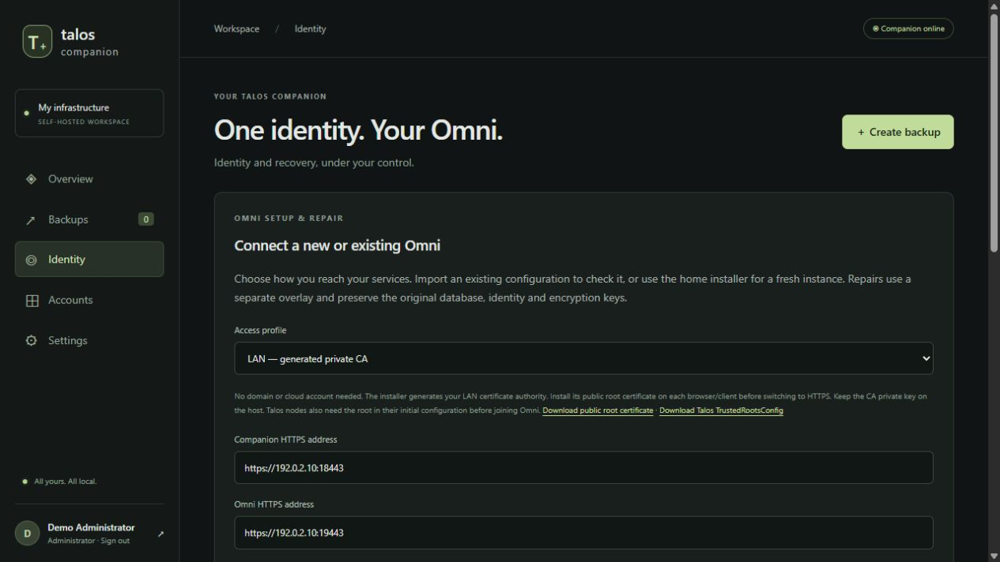
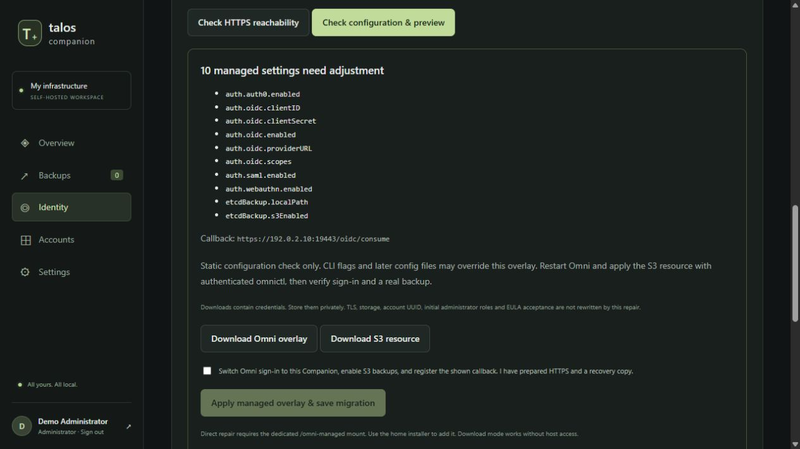
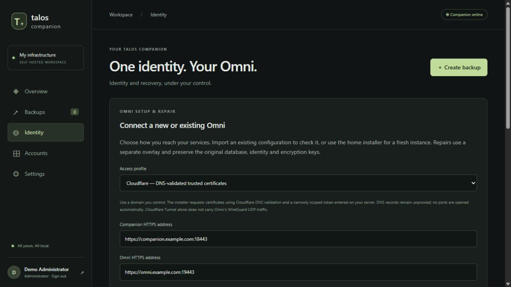
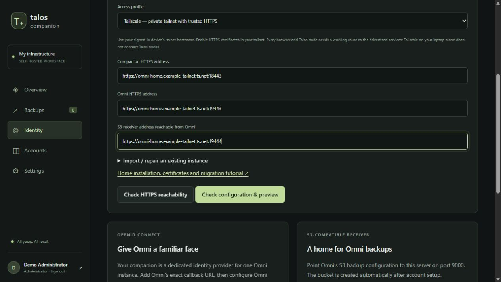
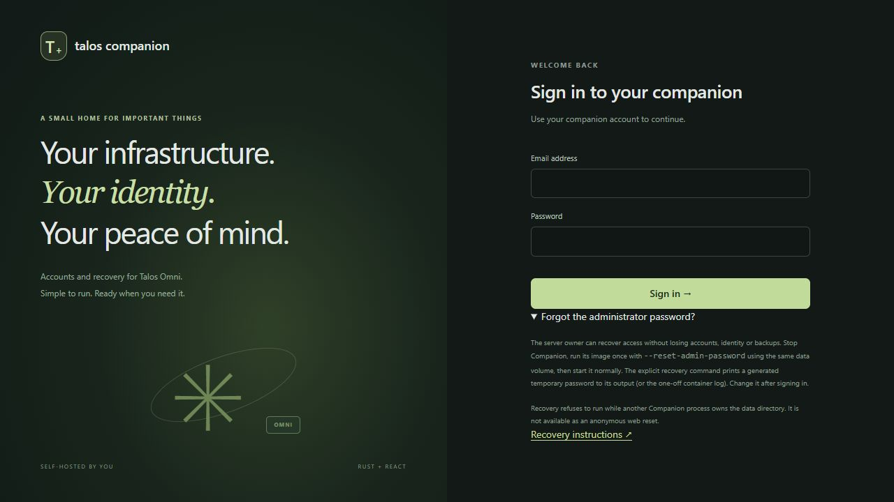

# Omni + Companion at home

This guide covers a **new, separate Omni instance**, an existing-instance repair workflow,
and migration between LAN, Cloudflare DNS and Tailscale access. Requires Companion 0.2.0
and uses official Omni v1.13.2. Screenshots use isolated demonstration data; never publish
screenshots of real credentials or private configuration.

## Choose an access profile

| Profile | What you need | Certificates and network |
| --- | --- | --- |
| LAN | Unraid's stable LAN IP | Helper creates a private CA and a one-year server certificate. Import the public root on clients and Talos nodes. No cloud account or domain. |
| Cloudflare DNS | Your domain, zone ID, scoped DNS token, contact email | ACME DNS-01 produces trusted certificates without inbound port 80. Helper creates **DNS-only** A records pointing to the LAN IP. No Internet ports are opened. Local DNS must allow these answers. |
| Tailscale | A signed-in Tailscale installation on Unraid, MagicDNS and HTTPS enabled | Helper uses the device's `.ts.net` hostname and `tailscale cert`. Clients need tailnet access. Talos nodes also need a route to that hostname/IP, or a LAN DNS override/subnet routing. |

Cloudflare DNS validation is different from Cloudflare Tunnel. A normal HTTP tunnel does
not carry SideroLink WireGuard UDP; do not assume exposing the browser UI connects nodes.
The helper keeps host port 51180/UDP for SideroLink. Remote nodes require an appropriate
VPN/routed UDP path or explicitly configured upstream gRPC tunnel mode.

## Before starting

1. Keep the existing Omni and its appdata intact. The helper uses new container
   `omni-companion` and new `/mnt/user/appdata/talos-omni-home` storage.
2. Finish Companion's first-run wizard, save its recovery passphrase outside Unraid,
   and create/download a recovery backup.
3. Reserve a static DHCP lease for Unraid. Check the listeners below are free.
4. Read [Omni's license](https://github.com/siderolabs/omni/blob/v1.13.2/LICENSE) and
   [EULA](https://siderolabs.com/eula/). Acceptance must be your own decision.
5. Review `scripts/home-setup.sh` before running it as root. It controls only its named
   managed containers, never deletes data volumes, and saves private rollback copies.
   It is an owner-run helper, not a daemon or Docker socket exposed to Companion.

| Service | Host port |
| --- | --- |
| Companion HTTPS | 18443/TCP |
| Fresh Omni HTTPS | 19443/TCP |
| S3 HTTPS receiver | 19444/TCP |
| Omni machine API (TLS) | 19090/TCP |
| Kubernetes proxy (TLS) | 19100/TCP |
| SideroLink WireGuard | 51180/UDP |
| Internal event / log sinks | 19091 / 19092 |
| Metrics | 127.0.0.1:12122 |

The existing HTTP Companion mapping 18480 and S3 mapping 19000 remain backend listeners.
Do not forward them to untrusted networks. Companion's final image remains one layer;
Caddy, Omni and one-off certificate/key tools are separate official images.

## Prepare a LAN installation

Copy the reviewed helper to Unraid, for example `/tmp/talos-home-setup.sh`, then run:

```sh
bash /tmp/talos-home-setup.sh --profile lan --phase prepare --host-ip YOUR_LAN_IP
```

Preparation creates a permanent account UUID, GPG database-encryption key, private LAN CA,
server certificate, scoped identity/backup overlay and configuration. It does **not**
replace or restart application containers. The target must be empty or marked as owned
by this helper. Preserve the entire dedicated directory.

The public root is at:

```text
/mnt/user/appdata/talos-omni-home/profiles/lan/tls/root-ca.crt
```

Download it using Unraid's file browser. Import **only `root-ca.crt`**, not a `.key` file.
On Windows, open the certificate, choose Install Certificate > Current User > Place all
certificates in the following store > Trusted Root Certification Authorities. Verify its
SHA-256 fingerprint against the server before trusting it. Some browsers/devices have a
separate trust store. Do not click through certificate warnings as a permanent solution.

After deployment, the public root is also available at `/api/omni/ca` and a generated
Talos `TrustedRootsConfig` at `/api/omni/talos-ca`. Include this public trust document in
the Talos node's initial/boot configuration **before its first TLS connection to Omni**.
Importing the root on a laptop does not configure node trust. Check your Talos release's
[TrustedRootsConfig schema](https://github.com/siderolabs/talos/blob/v1.14.0/pkg/machinery/config/types/security/trusted_roots.go).
This guide does not provision hardware or bypass node TLS validation.

## Apply the prepared installation

```sh
bash /tmp/talos-home-setup.sh --profile lan --phase apply --host-ip YOUR_LAN_IP
```

On the first application, the helper asks you to review the EULA, type `ACCEPT`, and
enter your own full name and email. Nothing accepts those terms for you. It then:

1. Saves private configuration rollback files and checks listener conflicts.
2. Upgrades/recreates Companion with the same data, adds a dedicated managed-overlay
   mount, and enables its new HTTPS issuer/callback. Passwords and recovery passphrase
   are preserved; sessions are cleared by restart.
3. Starts the Caddy HTTPS frontend and a separate Omni with host networking, NET_ADMIN
   and `/dev/net/tun`, as required by upstream. Privileged mode stays off.
4. Adds the LAN public root alongside Omni's existing public trust roots.
5. Uses a one-hour bootstrap administrator service account and official `omnictl` to
   apply the authenticated S3 configuration, then disables/revokes that account.

Open `https://YOUR_LAN_IP:18443` for Companion and `https://YOUR_LAN_IP:19443` for Omni.
Use your Companion account for Omni sign-in. If any step fails, inspect private logs;
a running container alone is not proof that sign-in or backups work.

## Check and repair from Companion

Open **Identity > Omni setup & repair**. Select a profile and enter the three origins.
The HTTPS reachability check validates TLS and an HTTP response, including the mounted
LAN public root. It does not claim successful OIDC sign-in or a real cluster backup.



Use **Check configuration & preview** to compare the imported primary configuration plus
the current managed overlay with Companion's OIDC/S3 settings. The preview lists changed
field names without revealing their values. You can download the overlay and S3 resource.
Those downloads contain credentials and must remain private.



Direct apply requires the dedicated `/omni-managed` directory. It writes only
`companion.yaml`, preserves a previous overlay in Companion's recovery vault, registers
the callback and saves the selected profile. It rejects stale previews. Restart Omni
after activating an overlay; restart Companion only after its new HTTPS endpoint is ready.
The web application does not restart containers or automatically accept legal agreements.

The checker covers OIDC provider/client/scopes, conflicting authentication provider
enablement, S3 mode and callback registration. It deliberately preserves database paths,
account UUID, GPG/TLS keys, initial administrator roles and unrelated configuration.
It cannot inspect startup flags or later configuration files remotely; those can override
the inspected settings. Verify the actual container invocation when importing an instance.

## Import an existing Omni instance

1. Back up its databases, configuration, account UUID and original encryption material.
2. In Companion's repair panel, upload its primary YAML/JSON config or paste it privately.
   It is inspected in memory, not uploaded to GitHub. Never supply a private key file.
3. Preview the changes. Switching authentication to Companion disables Auth0/SAML/WebAuthn
   in the managed overlay; it is an explicit administrator choice, not a background repair.
4. Download the overlay, mount a dedicated overlay directory read-only into Omni and
   read/write into Companion. Add the overlay as the **last** `--config-path`. Remove or
   reconcile conflicting CLI flags yourself after reviewing their effect.
5. Apply the downloaded S3 resource with an authenticated administrator `omnictl` session.
   Preserve existing Omni administrator emails/roles and check they map to Companion users.
6. Restart only the intended instance and verify its actual login and backup behavior.

Do not point the fresh-install helper at an unrelated existing database. It intentionally
refuses unmarked nonempty directories and is not an automatic database migration tool.

## Cloudflare profile and migration

Keep the same `--base` and LAN IP. Choose two hostnames within your zone, for example
`companion.example.com` and `omni.example.com`. Create an API token limited to that zone
with DNS Edit and Zone Read. Enter it only in the server prompt; do not paste it into chat,
screenshots, source code or command arguments. ACME stores renewal credentials privately
in the host's `acme` directory, which must be protected and backed up.

```sh
bash /tmp/talos-home-setup.sh --profile cloudflare --phase prepare \
  --host-ip YOUR_LAN_IP --companion-host companion.example.com \
  --omni-host omni.example.com --cloudflare-zone YOUR_ZONE_ID \
  --acme-email you@example.com
```

Preparation updates the two named A records to the supplied LAN address, with proxying
disabled, and issues a Let's Encrypt certificate using DNS-01. Confirm those records are
dedicated to this setup; changing an existing record changes where its clients connect.
Do not enable Cloudflare proxying for these arbitrary direct service ports. Some routers
block public DNS responses containing LAN addresses; configure local DNS if needed.



After certificate issuance, rerun the same command with `--phase apply`. This reuses the
permanent UUID, GPG key, data and Companion accounts, updates the issuer/callback and S3
endpoint, and recreates only the helper-owned services. Keep rollback copies and retain
the old access path until clients and Talos nodes have been updated. Old sessions and
tokens may need a fresh login. A profile change does not change the backup passphrase.

## Tailscale profile and migration

Install and sign in to Tailscale on Unraid first. Enable MagicDNS and HTTPS certificates
in the tailnet admin console. This helper reuses that existing authenticated host installation;
it does not enroll a new device or store an auth key in Companion.

```sh
bash /tmp/talos-home-setup.sh --profile tailscale --phase prepare --host-ip YOUR_LAN_IP
bash /tmp/talos-home-setup.sh --profile tailscale --phase apply --host-ip YOUR_LAN_IP
```

The helper reads the device's `.ts.net` hostname and requests its HTTPS certificate with
`tailscale cert`. Companion, Omni and S3 keep their distinct service ports. Review tailnet
access rules for those ports. For LAN Talos nodes that do not run Tailscale, provide a
working route to the tailnet IP or a LAN DNS override for that same hostname pointing to
Unraid's LAN IP. The certificate hostname stays unchanged. Verify this from the node network.



To return to LAN, rerun the LAN prepare/apply commands with the same base. The original
LAN CA is reused. Cloudflare DNS cleanup and Tailscale device removal are not automatic;
review shared records/devices before removing anything.

## Renewal and rollback

Schedule the helper's `--phase renew` command daily using Unraid User Scripts, with the
same profile, IP and any Cloudflare hostname/zone/contact arguments. Renewal restarts only
the managed proxy and Omni so they load certificates. LAN leaves are renewed when fewer
than 30 days remain; the ten-year LAN root is never silently replaced. Tailscale and
ACME manage their own renewal windows. Check the scheduled job's result and expiry dates.
No scheduler is silently installed on the host.

Private rollback configuration snapshots are in the helper's `rollback` directory. Restore
matching Companion state, Omni config, overlay and previous profile certificates while
the relevant services are stopped, then restart them with their previous mount paths.
Do not roll back a database across an incompatible Omni release. Keep an encrypted
Companion recovery bundle and an independent Omni database/encryption-key backup.

## Recover a forgotten administrator password



There is no anonymous web reset. A server owner with access to the persistent volume can
run this explicit, offline command. It generates a new 64-character password for the first
administrator, preserves identity/users/backups, and prints the new password only to the
recovery command's output (or its one-off container log). Normal restarts never print it.

```sh
docker stop talos-companion
docker run --rm --user 99:100 --read-only --cap-drop ALL \
  --security-opt no-new-privileges:true \
  -v /mnt/user/appdata/talos-companion:/data \
  holblin/talos-companion:0.2.0 --reset-admin-password
docker start talos-companion
```

If the installation uses explicit SETUP_TOKEN/BACKUP_PASSPHRASE overrides, provide its
original overrides privately to the recovery process. Never substitute a new backup
passphrase. An initialized installation refuses missing generated secret files.
Companion 0.2.0 locks its data directory so another 0.2.0 process cannot recover it while
running. Stop older versions explicitly too. Sign in with the generated password and
change it in Settings. Keep terminal/log output private.

## Verify before relying on the deployment

- Check Companion's Docker health status and Omni's private startup logs.
- Check all HTTPS addresses without a certificate warning.
- Sign in to Omni through Companion and confirm the intended administrator role.
- Register a test Talos node with the correct trust and route configuration.
- Check Omni's etcd backup overall status, trigger a real test-cluster backup and confirm
  the object arrives in Companion. A configured S3 resource alone is not a backup.
- Export a Companion recovery file, retain its passphrase separately, and test restore on
  an isolated instance. Back up Omni's own database and encryption material independently.

The helper automates host preparation and integration configuration. Cloudflare account
authorization, tailnet enrollment/HTTPS enablement, OS trust, EULA acceptance and physical
node provisioning remain owner-controlled actions. The Cloudflare and Tailscale paths
need validation with the owner's actual accounts; do not label a profile verified until
its DNS, TLS, routes, sign-in and backup checks have passed.
